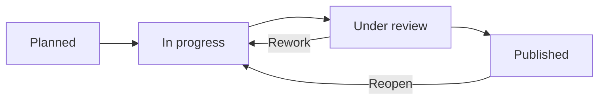

# Guided Benchmark Campaign Workflow

**Audience:** AI workgroup members. **Prototype:** [prototype.html](../prototype.html).
**Status:** Implemented workflow mock, persisted in browser `localStorage`.

## 1. Campaign is the main work item

Each Campaign has: stable ID, title, objective/hypothesis, owner, notes, mode, fixed scope, linked Test Cases, resumable sessions, recorded runs, review, publication state and audit history.

| Mode | Fixed at campaign level | Can vary between Test Case executions | Typical question |
| --- | --- | --- | --- |
| Solution-centred | Model, provider, harness, version, configuration and capabilities | Task, Test Case, experimental inputs and interactions | What tasks can one particular AI setup perform? |
| Task-centred | Engineering task (and shared challenge scope) | Model, provider, harness, configuration; Test Case and run | Which setup performs best for this task? |

A campaign starts **Planned**, then moves to **In progress**. New or existing reusable Test Cases can be attached while open. A Test Case is *not* a task-tree level and does not itself define a measured AI Solution.

A new AI Solution is registered from its **first measured benchmark run**, not from merely drafting a campaign. Later runs with exactly the same versioned setup reuse that identity.

## 2. Experimenter's guided Test Case record

**Step 1 — Campaign:** specify objective, mode, fixed setup or task, ownership, context and assumptions.

**Step 2 — Test Cases:** define or reuse an engineering challenge with task reference, inputs, protocol, expected outputs and DoD. In task-centred mode, Test Cases are restricted to the fixed task. Start a separate execution session for each trial; multiple attempts are allowed.

**Step 3 — Initial setup:** manually enter the experiment start date/time, approximate human preparation duration, initial prompts/instructions, input document names and references, supplied skills/tools/context and actual configuration. This is *experimental evidence*, not an installation tutorial.

**Step 4 — Timed interactions:** add any number of chronological entries, each recording:
- Date and time of the intervention
- Nature of the action (review, re-prompt, adjustment, restart, verification, etc.) and free-text explanation
- Approximate human active-work duration, separately from agent runtime/waiting duration
- Additional/changed prompts and intermediate artifacts

Save each entry to preserve the session. You can navigate back to the campaign and resume it. No automatic stopwatch or external harness integration is assumed.

**Step 5 — Outcome and closure:** record acceptance or failure against the DoD, quality and useful-information score (0–100), separate input/output tokens, AI/tooling cost, final runtime, human review and correction effort, final output documents/code/report references, produced deliverables, relevance/density observations and a conclusion.

Closing the execution produces an independent **Benchmark Run** and preserves the full timeline and snapshots of the original task, Test Case, protocol, AI configuration, components and campaign. **Failed results remain auditable evidence.** Closing an execution does not close the campaign.

## 3. Campaign lifecycle

- **In progress:** add Test Cases and execute or resume sessions.
- **Close → Under review:** stage the collected draft runs; no automatic public release.
- **Peer review:** a different workgroup member records the rationale and can approve publication or return the campaign to In progress. The prototype requires at least one completed run before publication.
- **Published:** controlled evidence becomes available for analytical results exploration. Publishing a failed run makes the failure visible; it does not constitute recommending the AI Solution.
- **Reopen:** allows more experiments even after publication. Historical runs remain unchanged.
- **Delete / archive:** truly empty campaigns can be deleted. Campaigns with sessions/runs are archived instead, preserving provenance and allowing restoration.

The **Dashboard is read-only** with columns Planned / In progress / Under review / Published. The **Benchmark Workspace** owns all actions; **Results Explorer** owns comparison and published-campaign evidence reading.

## 4. Source types and validity

Technology Watch predictions are **THEORETICAL**. If a staged forecast is selected for validation, the prototype starts a prefilled Campaign. Its guided run stores a snapshot of the original forecast. Changes from proposed configuration must be justified in the setup notes. Forecast evidence is never silently relabeled as measured.

When comparing AI configurations, disclose Test Case/protocol coverage and sample sizes, and distinguish missing tests from failures. Human-time fields are **approximately declared** and should never be represented as stopwatch measurements. Costs are estimated and need appropriate valuation assumptions.

## 5. Local demo and manual checks

Run `python3 -m http.server 8080`, open `http://localhost:8080/prototype.html`, sign in as **Maya Laurent** and follow:

1. Create a task-centred campaign, choose a task, add a Test Case, then open the campaign.
2. Start the Test Case; record configuration start time and input references.
3. Add two interventions with different timestamps, types and durations. Confirm both remain after page reload.
4. Close the execution as **Failed**, with token counts, cost and output references. Inspect the evidence timeline.
5. Close the campaign. Switch to **Sofia Ramos**, review, and publish it.
6. Reopen the campaign, add further tests, archive and restore; verify previous run evidence remains intact.
7. Repeat with **Solution-centred**, using a fixed setup across Test Cases belonging to different tasks.

**Implementation caveat:** Single-file browser prototype, mocked users/roles and data, no actual LLM calls, no background timer, no binary evidence storage. Paths and URLs are recorded as references, not uploaded content. Local data is not shared between browsers or machines. Real production security and artifact storage remain out of scope.
