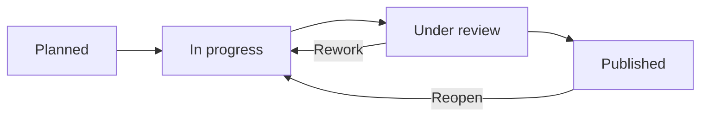

# Guided Benchmark Campaign Workflow

**Audience:** AI workgroup members. **Prototype:** [prototype.html](../prototype.html).
**Status:** Implemented workflow mock, persisted in browser `localStorage`.

## 1. Campaign is the main work item

Each Campaign has: stable ID, title, objective/hypothesis, owner, notes, mode, fixed scope, linked Test Cases, resumable sessions, recorded runs, review, publication state and audit history.

| Mode | Fixed at campaign level | Can vary between Test Case executions | Typical question |
| --- | --- | --- | --- |
| Solution-centred | Model, provider, harness, version, configuration and capabilities | Task, Test Case, experimental inputs and interactions | What tasks can one particular AI setup perform? |
| Task-centred | Engineering task (and shared challenge scope) | Model, provider, harness, configuration; Test Case and run | Which setup performs best for this task? |

A campaign starts **Planned**, then moves to **In progress**. New or existing reusable Test Cases can be attached while open. A Test Case is *not* a task-tree level and does not itself define a measured AI Solution.

A new AI Solution is registered from its **first measured benchmark run**, not from merely drafting a campaign. Later runs with exactly the same versioned setup reuse that identity.

## 2. Experimenter's guided Test Case record

**Step 1 — Campaign:** specify objective, mode, fixed setup or task, ownership, context and assumptions.

**Step 2 — Test Cases:** define or reuse an engineering challenge with task reference, inputs, protocol, expected outputs and DoD. In task-centred mode, Test Cases are restricted to the fixed task. Start a separate execution session for each trial; multiple attempts are allowed.

**Step 3 — Installation and setup:** select a reusable **Installation guide** from Guides & Charter or create one from the execution form. Guides may be linked to an existing AI Solution, or remain reusable/unassigned. Record actual installation timestamp, configured environment, human installation/preparation duration and deviations from the guide. **Do not capture the initial prompt here**; changing runtime options and supplying documents to the agent are interactions.

**Step 4 — Timed interactions:** record the first prompt (or first action) as the first interaction, followed by any number of timestamped follow-ups, supplied documents, skills/options activated, reviews, corrective prompts and intermediate outputs. Every entry has separate **human duration** and **agent duration**, in minutes. The **total agent runtime is the sum** of all iteration agent durations, without a second manually entered total.

**Step 5 — Results, artifacts and metrics:**
- **DoD**: accepted / failed, with failure preserved as evidence.
- **Quality (0–100)** and **Information Utility (0–100)**: sliders paired with exact numeric inputs and their adjacent free-text evaluation. Utility reflects relevance, novelty, correctness and actionability relative to noise/output volume.
- **Total tokens consumed (optional, if known)**: one numeric value multiplied by units/tens/hundreds/thousands/millions. A blank means unknown, not zero. Separate input/output counts are not required.
- **Cost**: choose **amount (EUR for this run)**, **flat-rate / subscription** (no allocated marginal cost), or **unknown**. A flat-rate or unknown amount must not be silently converted to zero.
- **Human time**: final review and correction times, separate from installation or per-iteration human effort; all times stored in minutes.
- **Produced outputs**: one required field listing final documents, code, reports, paths and references, followed by **Additional notes (optional)**. No duplicate output-description field.

Measurement labels expose guidance on hover/focus. Time sliders use a **nonlinear 0–7-day range**, paired with exact minute fields and dynamic minutes/hours/days displays. Scores use 0–100 sliders. See [Non-Functional Requirements](non-functional-requirements.md) for acceptance criteria.

Closing the execution produces an independent **Benchmark Run** and preserves the full timeline and snapshots of the original task, Test Case, protocol, AI configuration, components and campaign. **Failed results remain auditable evidence.** Closing an execution does not close the campaign.

## 3. Campaign lifecycle

- **In progress:** add Test Cases and execute or resume sessions.
- **Close → Under review:** stage the collected draft runs; no automatic public release.
- **Review:** the campaign owner or another workgroup member can record the rationale and approve publication or request rework. At least one completed run is required before publication.
- **Published:** controlled evidence becomes available for analytical results exploration. Publishing a failed run makes the failure visible; it does not constitute recommending the AI Solution.
- **Unpublish / Reopen:** a published campaign can return to Under review via Unpublish, or In progress via Reopen. Previous decisions and run evidence are retained.
- **Delete / archive:** truly empty campaigns can be deleted. Campaigns with sessions/runs are archived instead, preserving provenance and allowing restoration.

The **Dashboard is read-only** with columns Planned / In progress / Under review / Published. The **Benchmark Workspace** owns all actions; **Results Explorer** owns comparison and published-campaign evidence reading.

## 4. Source types and validity

Technology Watch predictions are **THEORETICAL**. If a staged forecast is selected for validation, the prototype starts a prefilled Campaign. Its guided run stores a snapshot of the original forecast. Changes from proposed configuration must be justified in the setup notes. Forecast evidence is never silently relabeled as measured.

When comparing AI configurations, disclose Test Case/protocol coverage and sample sizes, and distinguish missing tests from failures. Human-time fields are **approximately declared** and should never be represented as stopwatch measurements. Costs are estimated and need appropriate valuation assumptions.

## 5. Local demo and manual checks

Run `python3 -m http.server 8080`, open `http://localhost:8080/prototype.html`, sign in as **Maya Laurent** and follow:

1. Create a task-centred campaign, choose a task, add a Test Case, then open the campaign.
2. Start the Test Case; select or create an installation guide and record installation start time and human setup duration.
3. Record the first prompt and a correction as two interactions with different timestamps, types and durations. Confirm both remain after page reload.
4. Close the execution as **Failed**, with unknown tokens and a flat-rate cost, then repeat using scaled token counts and a run-specific EUR amount. Inspect the evidence timeline.
5. Close the campaign. Review and publish as **Maya Laurent**; optionally switch to **Sofia Ramos** for another review perspective.
6. Reopen the campaign, add further tests, archive and restore; verify previous run evidence remains intact.
7. Repeat with **Solution-centred**, using a fixed setup across Test Cases belonging to different tasks.

**Implementation caveat:** Single-file browser prototype, mocked users/roles and data, no actual LLM calls, no background timer, no binary evidence storage. Paths and URLs are recorded as references, not uploaded content. Local data is not shared between browsers or machines. Real production security and artifact storage remain out of scope.
