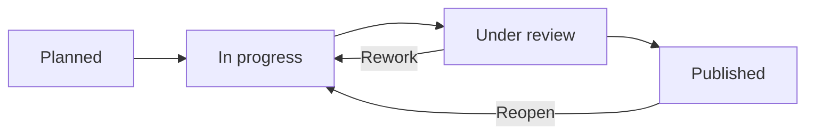

# Guided Benchmark Campaign Workflow

**Audience:** AI workgroup members. **Prototype:** [prototype.html](../prototype.html).
**Status:** Implemented workflow mock, persisted in browser `localStorage`.

## 1. Campaign is the main work item

Each Campaign has: stable ID, title, objective/hypothesis, owner, notes, mode, fixed scope, optional **Framework with one or more registered participant trios**, a **referenced Setup Guide**, **zero or more linked technological signals (Technology Watch entries)**, linked Test Cases, resumable sessions, recorded runs, review, publication state and audit history. Signals can be selected at creation/editing. Creating a campaign to validate a forecast preselects its linked watch signals; changes to the campaign links are reviewable and traceable.

| Mode | Fixed at campaign level | Can vary between Test Case executions | Typical question |
| --- | --- | --- | --- |
| Solution-centred | Model, provider, harness, version, configuration and capabilities | Task, Test Case, experimental inputs and interactions | What tasks can one particular AI setup perform? |
| Task-centred | Engineering task (and shared challenge scope) | Model, provider, harness, configuration; Test Case and run | Which setup performs best for this task? |
| Framework enabled (either mode) | One Framework plus an editable set of labeled participant configurations | Executed participant selected for each Test Case session | How do registered Framework participants perform under the selected challenges? |

A campaign starts **Planned**, then moves to **In progress**. New or existing reusable Test Cases can be attached while open. A Test Case is *not* a task-tree level and does not itself define a measured AI Solution.

A new AI Solution is registered from its **first measured benchmark run**, not from merely drafting a campaign. Later runs with exactly the same versioned setup reuse that identity.

## 2. Experimenter's guided Test Case record

**Step 1 — Campaign:** specify objective, mode, fixed setup or task, ownership, context and assumptions. Select **one, several or no technological signals** from the Technology Watch catalog. Optionally select a **Framework** and configure one or more participant instances. Each instance has its own model/provider/harness trio, role, exact parameters, revision and capabilities. The Framework is an orchestration/workflow layer, **not** an AI model or an independently measured AI Solution. Select a previously catalogued **Setup Guide**, or create one inline with **title plus text and/or a URL**. Campaigns store the guide reference and preselect it for subsequent executions. These links are contextual evidence, not proof of measured performance.

**Step 2 — Test Cases:** define or reuse an engineering challenge with task reference, inputs, constraints, expected outputs and DoD. No separate benchmark protocol is selected. In task-centred mode, Test Cases are restricted to the fixed task. Start a separate execution session for each trial; multiple attempts are allowed. The Test Design page groups Test Cases by task and presents explicit parent/fork lineage; forking allocates the next available child version on save.

**Step 3 — Installation and setup:** use the campaign's preselected **Setup Guide**, choose another compatible guide from Guides & Charter, or create a new reusable entry inline, using procedure text, an HTTP(S) URL or both. Every guide is referenced through a stable catalog ID. For Framework campaigns, choose **Individual participant** for a single independently scored AI Solution, or **Collaborative workflow** and select at least two participant instances for an overall Framework score. The selected participant(s), orchestration notes, and deployed configuration are pinned in session and run evidence. Guides may be linked to an existing AI Solution, to a Framework, or remain reusable/unassigned. The selector offers generic guides and guides linked to the **exact selected AI Solution configuration** (including model/provider/harness, versions and settings), never guides associated only by superficially matching component names. As the setup changes, the guide choices refresh; a newly created guide can remain unassigned if the configuration has not yet produced a measured AI Solution. Record actual installation timestamp, configured environment, human installation/preparation duration and deviations from the guide. **Do not capture the initial prompt here**; changing runtime options and supplying documents to the agent are interactions.

**Step 4 — Timed interactions:** record the first prompt (or first action) as the first interaction, followed by any number of timestamped follow-ups, supplied documents, skills/options activated, reviews, corrective prompts and intermediate outputs. Every entry has separate **human duration** and **agent duration**, in minutes. Documents introduced and skills/options activated during a trial are stored with their respective interactions, not misclassified as installation evidence. The **total agent runtime is the sum** of all iteration agent durations, without a second manually entered total.

**Step 5 — Results, artifacts and metrics:**
- **DoD**: accepted / failed, with failure preserved as evidence.
- **Quality (0–100)** and **Information Utility (0–100)**: sliders paired with exact numeric inputs and their adjacent free-text evaluation. Utility reflects relevance, novelty, correctness and actionability relative to noise/output volume.
- **Total tokens consumed (optional, if known)**: one numeric value multiplied by units/tens/hundreds/thousands/millions. A blank means unknown, not zero. Separate input/output counts are not required.
- **Cost**: choose **amount (EUR for this run)**, **flat-rate / subscription** (no allocated marginal cost), or **unknown**. A flat-rate or unknown amount must not be silently converted to zero.
- **Human time**: final review and correction times, separate from installation or per-iteration human effort; all times stored in minutes.
- **Produced outputs**: one required field listing final documents, code, reports, paths and references, followed by **Additional notes (optional)**. No duplicate output-description field.

Measurement labels expose guidance on mouse hover or keyboard focus, and the full explanation is available to assistive technology. Time sliders use a **nonlinear 0–7-day range**, paired with exact minute fields and dynamic minutes/hours/days displays. Scores use 0–100 sliders. See [Non-Functional Requirements](non-functional-requirements.md) for acceptance criteria.

Closing the execution produces an independent **Benchmark Run** and preserves the full timeline and snapshots of the original task, Test Case, selected participant's AI configuration, optional Framework, reused Setup Guide (including URL and text), components and campaign (including linked signal snapshots). **Failed results remain auditable evidence.** Closing an execution does not close the campaign.

**Composite Framework attribution:** a Framework campaign may register several participant trios. In **individual** mode, one participant is measured and its exact model/provider/harness combination is recorded as the AI Solution. In **collaborative** mode, at least two participant instances are selected together and the output, quality, utility, runtime and cost are stored as a **composite Framework Run**. The overall result is distinct from any individual AI Solution scores; existing individually measured solution references, where present, are contextual only. Each timed interaction can optionally identify the responsible participant or Framework-wide coordinator. The framework's documented workflow wiring/handoffs and all selected participant snapshots are retained. This prototype stores the declared orchestration and measurements, but does not automatically invoke real agents.

## 3. Campaign lifecycle

- **In progress:** add Test Cases and execute or resume sessions.
- **Close → Under review:** stage the collected draft runs; no automatic public release.
- **Review:** the campaign owner or another workgroup member can record the rationale and approve publication or request rework. At least one completed run is required before publication.
- **Published:** controlled evidence becomes available for analytical results exploration. Publishing a failed run makes the failure visible; it does not constitute recommending the AI Solution.
- **Unpublish / Reopen:** a published campaign can return to Under review via Unpublish, or In progress via Reopen. **Unpublish retracts the campaign's public runs** and restores the draft state of a benchmark-generated AI Solution only if no other published run still supports it; reopening for additional tests does not in itself unpublish previously released evidence. Previous decisions and run evidence are retained.
- **Delete / archive:** truly empty campaigns can be deleted. Campaigns with sessions/runs are archived instead, preserving provenance and allowing restoration.

The **Dashboard is read-only** with columns Planned / In progress / Under review / Published. The **Benchmark Workspace** owns all actions; **Results Explorer** owns comparison and published-campaign evidence reading.

## 4. Source types and validity

A selected technological signal is a referenced **hypothesis**, not a benchmark outcome. Its ID and source snapshot are stored in new run records. Published campaign views must not disclose the details of unpublished watch signals to non-workgroup readers. Pre-existing runs retain any historical protocol metadata solely for backward compatibility; new run forms do not request or create it.

Technology Watch predictions are **THEORETICAL**. If a staged forecast is selected for validation, the prototype starts a prefilled Campaign. Its guided run stores a snapshot of the original forecast. Changes from proposed configuration must be justified in the setup notes. Forecast evidence is never silently relabeled as measured.

When comparing AI configurations, disclose Test Case coverage, execution conditions and sample sizes, and distinguish missing tests from failures. Human-time fields are **approximately declared** and should never be represented as stopwatch measurements. Costs are estimated and need appropriate valuation assumptions.

## 5. Local demo and manual checks

Run `python3 -m http.server 8080`, open `http://localhost:8080/prototype.html`, sign in as **Maya Laurent** and follow:

1. Create a task-centred campaign, choose a task and two or more existing Technology Watch signals, add a Test Case, then open the campaign. Edit the campaign and verify multiple checked signals remain selected; confirm the linked signals are shown in campaign details.
2. At campaign creation, choose a catalogued Setup Guide or register a new URL-only guide. Reopen the campaign and verify it is linked. Start a Test Case: the guide must be preselected, or a new compatible guide may be chosen/created. Record installation start time and human setup duration. Confirm generic guides are available, guides from a different AI configuration are excluded, and switching between existing configurations refreshes the options.
3. Record the first prompt and a correction as two interactions with different timestamps, types and durations; introduce an input file and a skill at a chosen interaction. Confirm they remain in the interaction timeline (not the installation record) after page reload. Focus an ⓘ help icon with the keyboard and verify its explanation appears.
4. Close the execution as **Failed**, with unknown tokens and a flat-rate cost, then repeat using scaled token counts and a run-specific EUR amount. Inspect the evidence timeline.
5. Close the campaign. Review and publish as **Maya Laurent**; optionally switch to **Sofia Ramos** for another review perspective.
6. Reopen the campaign, add further tests, archive and restore; verify previous run evidence remains intact.
7. Repeat with **Solution-centred**, using a fixed setup across Test Cases belonging to different tasks. Separately, fork an existing Test Case twice: check that versions are distinct (e.g., 1.0.1 and 1.0.2), that both appear as children of the source, and that a nested fork receives 1.0.1.1. Check that no Protocol tab or protocol selector is displayed.

8. Create a **Framework campaign** using n8n or Spec Kit and define two participants with different labels/trios and workflow handoff notes. Reopen the campaign and verify they persist. Start a Test Case in **Collaborative workflow** mode with both participants selected, log an interaction attributed to each, and close the run. Verify one composite Framework result with no falsely attributed individual AI Solution score; then perform a separate **Individual participant** execution and verify its individual measured solution identity. Repeat using text-only, URL-only and mixed Setup Guides.

**Implementation caveat:** Single-file browser prototype, mocked users/roles and data, no actual LLM calls, no background timer, no binary evidence storage. Paths and URLs are recorded as references, not uploaded content. Local data is not shared between browsers or machines. Real production security and artifact storage remain out of scope.
