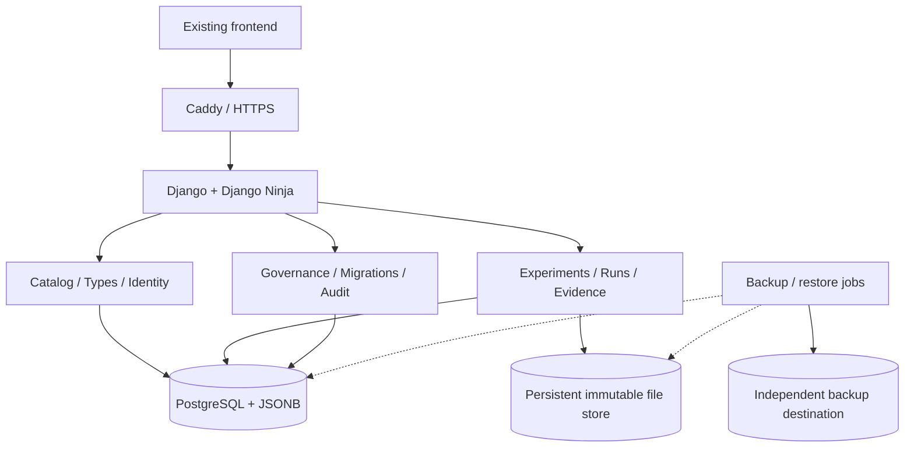

# AI Compass — Platform Architecture, Persistence & Data Governance

> **Status:** Architecture baseline — agreed direction; implementation pending  
> **Decision date:** 2026-10-09  
> **Scope:** Backend, persistence, immutable history, identifiers, schema evolution, documents, backups, deployment, roles and maintenance tooling  
> **Related:** [Product Definition](product-definition.md) · [Non-Functional Requirements](non-functional-requirements.md) · [Benchmark Workflow](benchmark-workflow.md) · [Incremental Implementation Roadmap](platform-implementation-roadmap.md)  
> **Principle:** *Preserve evidence first. Every transformation must be traceable, verifiable and recoverable.*

This page consolidates the platform-level decisions for a **permanent dual-mode platform**: the original standalone browser/localStorage demonstration and a persistent multi-user server deployment. Both modes must use **the same frontend** and the same business presentation; backend adoption must not remove the browser-only alternative. It specifies architectural **intent and invariants**, not a claim that all capabilities are already implemented. **Implementation status:** PLAT-01 (Docker/PostgreSQL), PLAT-02 (session authentication and RBAC), and PLAT-03 (versioned immutable Model REST API) have been delivered; see [Model Catalog Architecture](model-catalog-architecture.md). The product definition remains authoritative for business workflows; this page is authoritative for the target technical direction.

## 1. Architecture drivers and non-negotiable invariants

1. **Never silently discard information.** Keep original evidence, historical object revisions, retired fields, source references, migration reports, and attributable audit records. Destructive changes require explicit, separately controlled retention/erasure policy; “immutability” is not an excuse to ignore lawful deletion obligations.
2. **Preserve historical meaning.** Benchmark runs, test cases, guides and recommendations must refer to the exact component/configuration, schema and method revisions used at the time. Recalculation produces new derived results; it does not overwrite old measurements.
3. **Evolve without mandatory rewrites.** New object types and most new properties should not require a SQL table migration or break old documents. Schema definitions and transformations are versioned.
4. **Make incompatibility explicit.** Old/partial/unavailable/invalid data must be distinguishable in the API and UI, without preventing access to unaffected functionality.
5. **Separate evidence from interpretation.** Original uploaded files, raw traces and observed measurements are preserved independently of extracted fields, analyses, scoring algorithms, recommendations and corrected views.
6. **Recoverability is demonstrated.** Backups, snapshots, checksum verification, documented restore procedures and regular restore tests are part of the product, not operational afterthoughts.
7. **Keep operations understandable.** Start with one modular backend and one database on a Linux host; introduce infrastructure only when required by measured load or reliability constraints.
9. **Retain standalone Demo mode permanently.** The same frontend must work with realistic fake data held in browser `localStorage` without a backend, while Server mode uses PostgreSQL through APIs. Never silently mix, sync or fall back between the two.
8. **Enforce least privilege.** Business contribution, publication, data stewardship, user administration and platform operations are independent capabilities.

**Limit of guarantee:** No single database, local disk or backup scheme can guarantee literally zero data loss under all failures. The design minimizes and measures loss risk using transactional durability, immutability, independent copies and verified recovery.

## 2. Two permanent runtime modes and selected technology stack

| Property | Demo mode | Server mode |
| --- | --- | --- |
| Frontend | Shared UI components | **Exactly the same** UI components |
| Data provider | `LocalStorageDataProvider` with seeded, clearly fake fixtures | `ApiDataProvider` backed by Django Ninja and PostgreSQL |
| Runtime | Static HTML/assets; no Docker, Python application server or database required | Caddy + Django + PostgreSQL via Docker Compose |
| Authentication | Clearly simulated demo identities and privileges | Authenticated, enforced server-side permissions |
| Persistence | Local to browser and origin, exportable/resettable | Shared database and immutable server evidence store |
| Availability | Works independently/offline once static files are available | API/DB availability required; **never fall back to fake data** |
| Data interchange | Explicit export/import or opt-in migration only | Explicit staged import with preview and reconciliation only |

**Data-provider contract:** UI state and business operations should depend on a shared interface (list/get/create/revise and domain-specific actions), implemented by both adapters with compatible output contracts. No view should contain branching business logic such as `if (demo) localStorage... else fetch...`; mode resolution is centralized in the application bootstrap. Demo data and server data must remain separately namespaced and visibly labeled. Do not auto-copy fake demo records into Server mode, or live records into Demo mode. Provide explicit mode selection/configuration and prevent automatic fallback on HTTP/API errors. Maintain regression smoke tests for **both modes** for every frontend change. The current monolithic `prototype.html` remains the reference implementation for Demo mode until the common data-provider extraction is introduced incrementally.

**Delivery ordering:** issue #1 keeps `prototype.html` fully functional in Demo mode and exposes health-only Server infrastructure. Server-mode catalog/business operations appear incrementally in subsequent issues; until then, those Server features are shown as not yet available, not silently populated from local fake data.


| Layer | Baseline | Rationale / boundary |
| --- | --- | --- |
| Backend application | **Python + Django 5.2 LTS** | Mature ORM, authentication, authorization, admin, migrations and cohesive modular monolith. |
| Typed REST API | **Django Ninja** | Typed request/response contracts and generated OpenAPI; the browser never directly accesses the DB. |
| Persistent database | **PostgreSQL** | Transactional constraints, concurrent access, JSONB, indexing, WAL and PITR capability. |
| Flexible properties | **PostgreSQL JSONB + versioned JSON Schema** | Extensible catalog/object attributes while retaining typed validation. |
| Relational schema migrations | **Django migrations** | Version-controlled physical database evolution. |
| Business/data migrations | **Versioned application migration engine** | Dry-run, validation, audit, batching, restartability and review of ambiguous changes. |
| File/blob store | **Persistent filesystem, storage adapter** | Immutable content-addressed objects on disk now; S3-compatible storage may be added later. |
| Backup/recovery | **pgBackRest + Restic** | PostgreSQL-aware backups/WAL; separate document snapshots, manifest and off-host copies. |
| Containers | **Docker Compose** | Straightforward single-host deployment with persistent bind mounts/volumes. |
| Reverse proxy / TLS | **Caddy** | HTTPS termination and frontend/API routing. |
| Application server | **Gunicorn** | Serve Django behind the proxy. |
| Frontend | **Retain the existing browser UI, in both modes** | Introduce an adapter (`LocalStorageDataProvider` / `ApiDataProvider`) behind the same screens; preserve offline fake-data mode while adding server persistence incrementally. |

**Not initially required:** Kubernetes, microservices, event brokers, Redis, Celery, MinIO/S3 services or a dedicated distributed workflow engine. Introduce a dedicated background worker when long-running data migrations, scans or file processing justify one; first use isolated management commands and scheduled jobs.

**Alternatives assessed:** SQLite + lightweight API is adequate for a local prototype but less suitable as the central concurrent evidence repository and for PostgreSQL-style backup/restore operations; FastAPI + SQLAlchemy + Alembic is viable but entails more plumbing than Django for this team; microservices add operational and consistency complexity too early.

Pin dependency versions and container images. Prefer maintained LTS releases; schedule controlled upgrades and regression tests, rather than treating a particular version as permanent.

## 3. Target deployment and modular backend



Suggested bounded modules (one deployable backend, not network microservices):

- `identity`: UUIDs, human-readable IDs, users, groups, role assignments and permissions.
- `catalog` / `object_types`: Models, Providers, Harnesses, Frameworks, extensible type registry and schemas.
- `taxonomy`: editable multilevel task hierarchy.
- `experiments`: campaigns, Test Cases, participant trios, test sessions, runs, results and frozen configurations.
- `evidence`: source records, file metadata, blobs, provenance, links and integrity.
- `knowledge`: Setup Guides, charters, recommendations, watch/forecasts, discussions.
- `governance`: health checks, maintenance issues, quality review, exceptions and stewardship dashboard.
- `migrations`: schema compatibility, registered transformations, plans, executions and reports.
- `audit`: attributable, append-only activity and change events.
- `operations`: scheduled checks, backups/export orchestration and recovery status.

Important business distinctions inherited from the product definition:

- A **Framework** coordinates zero or more separately configured Model–Provider–Harness participants; a composite run does not silently impute collective metrics to an individual AI Solution.
- A **Test Case** is an independent, versioned experimental instance linked to the editable task taxonomy, **not** a task-tree category.
- An **AI Solution** is a measured configuration registered from its first controlled run; catalog candidates and theoretical forecasts remain distinct.
- **Setup Guides** are independently identified reusable knowledge objects, with a frozen reference/snapshot in run evidence.
- Published, staged, theoretical and observed records retain their different evidentiary status and visibility rules.

## 4. Data model: stable relations + flexible properties

**Hybrid model:** stable, high-integrity fields use relational columns and foreign keys; type-specific, rapidly changing properties reside in validated `JSONB`.

An illustrative catalog item has:

| Stable relational fields | Flexible JSONB properties |
| --- | --- |
| `id` (UUIDv7), `public_id`, `type_id`, `current_revision_id`, `created_at`, `owner`, `lifecycle_status` | Model context capabilities, reasoning modes, modality details, benchmark-specific attributes, custom extensions, etc. |

The main persistent concepts (names are indicative, **not** a frozen SQL schema):

| Entity | Purpose |
| --- | --- |
| `object_identity` / `catalog_item` | Stable identity and object type; independent of revisions. |
| `object_type` / `object_type_version` | Registry of type names, stable prefixes and immutable JSON Schema definitions. |
| `object_revision` | Immutable content snapshot, schema version, author, timestamp, predecessor and optional content hash. |
| `benchmark_run` / `configuration_snapshot` | Execution with exact participant/component revisions, settings, task/Test Case revision and results. |
| `evidence` / `evidence_blob` / `evidence_link` | Original evidence metadata, hashed file bytes, and immutable/traceable links to objects or revisions. |
| `evaluation_revision` / `recommendation_revision` | Distinct versioned interpretations, scoring method and published decisions. |
| `migration_definition` / `migration_execution` | Registered transformation, version/path, dry-run and applied outcome with evidence. |
| `maintenance_issue` / `quality_check` | Detected defects, assignments, dispositions, exceptions and checks. |
| `audit_event` | Attributed security, governance, business and data-change activity. |

**Rules:**

- Primary relationships (e.g. campaign → run → Test Case, evidence → run/revision, participant → model/harness/provider revision) use actual FK/relational links; do not bury the referential backbone in JSON strings.
- Each revision records its **authoring schema version**. A schema definition is never edited in place after use.
- JSONB flexibility does **not** mean unvalidated data: enforce JSON Schema and contextual business constraints at the API/service boundary.
- Index frequently queried stable columns; add targeted JSONB indexes only when usage justifies them. Avoid an indiscriminate “everything in one JSON column” design.
- Object retirement, archival, publication state, schema compatibility and data-quality freshness are **separate axes**.

## 5. Stable identities, human-readable IDs and revisions

Every durable business object requiring an ID receives two immutable identifiers plus a mutable display label:

1. **Technical ID:** UUIDv7 used for DB keys and foreign keys.
2. **Public ID (HRID):** `<type-prefix>-<word>-<word>-<word>`, for example `mdl-quiet-silver-fox`.
3. **Display name:** freely editable (changes are tracked), for example `GLM-5.2`.

Initial prefix vocabulary (subject to central registration, then frozen):

| Type | Prefix | Example |
| --- | --- | --- |
| Model | `mdl` | `mdl-quiet-silver-fox` |
| Provider | `prv` | `prv-bright-oak-river` |
| Harness | `hrn` | `hrn-calm-blue-falcon` |
| Framework | `frm` | `frm-green-stone-moon` |
| Campaign | `cmp` | `cmp-swift-gold-forest` |
| Run | `run` | `run-small-red-cedar` |
| Test Case | `tcs` | `tcs-clear-blue-lake` |
| Evidence | `evd` | `evd-soft-green-maple` |
| Setup Guide | `gui` | `gui-quiet-white-cloud` |
| Task | `tsk` | `tsk-bright-gray-wolf` |
| Maintenance issue | `mnt` | `mnt-calm-white-river` |

Apply the policy consistently to other durable identified objects (AI Solution, Watch Entry, forecast, stored external source, discussion where relevant); reserve their prefixes in the registry instead of inventing them ad hoc. A component's type change does **not** automatically rename its historical public ID.

**Generation:** use a curated/versioned word dictionary and a cryptographically secure random generator. A central `IdentityService` constructs the candidate and atomically inserts/reserves it under a global database `UNIQUE(public_id)` constraint; on collision, retry. Example with three independent 512-word lists: 512³ possible combinations **per prefix**, not a probabilistic uniqueness guarantee. Never reuse an assigned HRID, even after archival/deletion. Dictionary changes affect only future IDs. HRIDs are **not authorization tokens** and must not encode sensitive information.

**Revision reference:** `mdl-quiet-silver-fox@r003` is a convenient human-facing form; internal relations point to an exact immutable revision UUID (not a mutable “latest” pointer). Revision counters are unique/monotonic within each object and allocated transactionally. The object's `public_id` remains fixed across all revisions.

Imported records preserve canonical IDs and provenance where possible. Collision/mapping conflicts are surfaced explicitly and resolved with a logged import mapping; never silently replace another object's identity.

## 6. Immutable evidence and historical reproducibility

- **Raw evidence:** original uploaded documents, logs, prompt/transcript artifacts, source captures and measurements are immutable once committed.
- **Derived data:** parsed/extracted records and analysis outputs have their own provenance (source hashes, extraction method/version, timestamp).
- **Interpretation:** scored evaluations, qualifications, recommendations and publications are independently versioned, with method/version references.
- **Object modifications:** append an `object_revision`, advance the current-revision pointer transactionally, and record an attributable audit event; never UPDATE an old revision's payload.
- **Run snapshots:** freeze the exact Test Case, guides, source/evidence references, each participant's Model/Provider/Harness revisions, framework revision, prompt/settings, environment and evaluation method. Subsequent catalog edits do not alter prior benchmark meaning.
- **Correction:** append a superseding revision, correction note or revocation/qualification event; do not silently rewrite historical outcomes.
- **Removal:** prefer archive/retire/tombstone. Exceptional authorized legal/security erasure follows an explicit auditable policy with scoped impact; do not promise absolute immutability in conflict with such obligations.

Append-only application design and DB constraints should protect immutable tables. The audit stream is evidence of operations, but a regular DB administrator is not cryptographically prevented from rewriting a local database; higher-assurance tamper evidence (signed manifests, independent log copies) may be introduced if the threat model requires it.

## 7. Two independent kinds of migration

### 7.1 Physical database/schema migrations

Django migrations, tracked with source code, for new tables, indexes, constraints and relational changes. Apply via a controlled deployment workflow with preflight checks and a recoverable backup. Use staged **expand → backfill → switch reads/writes → contract** changes when old and new app versions may overlap or changes are too large for one transaction.

A SQL migration must **not** silently drop legacy evidence fields or cascade-delete evidence-bearing relationships.

### 7.2 Semantic/object-data migrations

An application-level engine upgrades one versioned JSON Schema representation to another:

```text
Model schema v2 --> Model schema v3
 context_window: 200000
                  becomes
 context_window: { tokens: 200000,
                   measurement_method: null,
                   verified_at: null }
```

Unknown facts remain unknown (`null` plus explicit completeness/quality status), never fabricated. Source revision is retained and a new revision is written with the transformation ID and result.

**Compatibility states:**

| State | Behavior |
| --- | --- |
| `current` | Normal operations. |
| `outdated` | Old schema; supported read adapter. |
| `migration_available` | Registered upgrade path; offer migration. |
| `needs_review` | Ambiguity/missing facts; human stewardship. |
| `unsupported` | No safe adapter; raw/read-only view and export. |
| `invalid` | Validation failure; quarantine unsafe operation and raise an issue. |

These are **schema/data compatibility** states, not business lifecycle states (`active / deprecated / retired / archived`).

**Required migration procedure:**

1. Discover affected objects and dependent revisions/references.
2. Validate prerequisites and registered transformation path.
3. Dry-run without writing; produce per-object change previews, counts, ambiguous fields and blockers.
4. Take and verify an appropriate recovery point before material changes.
5. Execute in idempotent, resumable, bounded transactions/batches; lock or compare revision versions to prevent concurrent lost updates.
6. Validate the new revision against target schema and business invariants.
7. Record old/new revision IDs, transformation version, operator, timestamps, checksums, exceptions and the report.
8. Expose completion/partial failure, recover/retry options and residual manual-review queue.

The **Maintenance UI** may trigger only reviewed and registered data migrations with explicit permissions. Arbitrary SQL/Python execution from the browser is forbidden. Complex DB migrations and code changes remain controlled deployment operations. Both development/offline and authorized web-driven *business* migrations must be possible.

**Compatibility adapter strategy:** read old data via version-aware adapters when safe. Never require an immediate mass rewrite to open the UI; the API returns a compatibility envelope and keeps original content accessible.

## 8. Frontend/API compatibility and safe degradation

All persistent operations use a versioned Django Ninja REST API (e.g. `/api/v1/`). The browser must not directly access PostgreSQL or local evidence files.

An object response may include:

```json
{
  "id": "mdl-quiet-silver-fox",
  "type": "model",
  "schema_version": 2,
  "revision": "r003",
  "compatibility": {
    "status": "needs_review",
    "target_version": 3,
    "migration_available": true
  },
  "data": { "context_window": 200000 }
}
```

Requirements:

- API contracts remain backward compatible within an announced API version or expose an explicit new version.
- Differentiate missing, unknown, null, unavailable, unsupported and access-denied states; do not substitute zero for unknown measurements.
- Render available known properties; show a generic safe read-only representation of unknown/unsupported object types or schema revisions, with raw export when authorized.
- Disable only actions requiring absent/incompatible fields rather than crashing entire screens.
- Migration logic resides in the backend. UI components must not embed the complete historical transformation rules.
- Enforce access policy server-side; hiding a button or sidebar section is **not** authorization.
- The localStorage prototype remains a **permanent, first-class Demo runtime**, not a temporary migration source. An opt-in import from its export into Server mode must preserve existing IDs/history as far as available, create a reconciliation report and retain the original export. Server mode alone is authoritative for shared production data; Demo mode alone is authoritative for its local fake dataset.

## 9. Durable document storage and secure upload

Initial storage is a persistent filesystem volume **separate from PostgreSQL**. Implement a storage-adapter interface so later S3-compatible storage does not alter logical evidence IDs.

**Blob layout:** content-addressed files keyed by SHA-256, e.g. `/data/evidence/blobs/ab/cd/<sha256>`. A metadata row records hash, original filename, MIME/media type, size, uploader, timestamp, source, access classification, logical evidence ID and referenced objects/revisions. Same-content bytes may be deduplicated without merging distinct provenance records.

**Safe ingest protocol:**

1. Authenticate/authorize; enforce size, type, quota and access constraints. Treat user input and file contents as untrusted.
2. Stream to a private temporary area; compute/check hash, enforce size limits and perform required malware/content scanning before release.
3. Flush/synchronize and atomically rename into immutable content-addressed storage **on the same filesystem**.
4. Commit metadata/links in PostgreSQL only after the blob is durably available; use idempotency/reconciliation to address the absence of a single transaction spanning DB and filesystem.
5. Periodically detect missing/orphan files, verify hashes and reconcile failed uploads; never delete an orphan automatically before retention/recovery checks.

Never execute uploads or expose raw upload paths through the web server. Use an application-controlled download endpoint or safely scoped signed access with permission checks, safe response headers and isolation.

**Storage migration:** copy + integrity-verify blobs, switch adapter, retain old copies until independent restore and reconciliation succeed.

## 10. Backup, snapshot, disaster recovery and export

History, backup and high availability solve different problems:

| Mechanism | Purpose |
| --- | --- |
| Immutable revisions / audit | Explain and reverse individual logical changes. |
| PostgreSQL backup + WAL/PITR | Recover a consistent DB state after errors/failures. |
| File/object backup | Recover original evidence bytes. |
| Coordinated recovery snapshot | Restore mutually consistent DB references and evidence blobs. |
| Separate physical/off-host backup | Survive failure or loss of the production disk/host. |
| Portable logical export | Escape long-term product/schema obsolescence. |

**Baseline policy (initial target, to be tuned to actual risk/capacity):**

- Backup before major migrations; nightly coordinated database + document backup.
- PostgreSQL-aware backups via pgBackRest; enable/archive WAL when low-RPO PITR is configured.
- Versioned/encrypted evidence-file backups via Restic; at least one independent destination not on the same disk.
- Weekly backup/integrity checks; monthly **restore to a clean isolated environment**, including object counts, FK integrity and file hash verification.
- Track **RPO** (maximum tolerable lost recent data) and **RTO** (maximum acceptable restore duration). A few-minute RPO is a **later target**, not a promise of the first deployment.
- For a simple first release, it is acceptable to suspend new writes briefly while capturing a consistent backup manifest/restore point; non-blocking coordinated backups can follow.
- Never equate Docker volumes or same-disk filesystem snapshots with a disaster-recovery backup.

**Portable export** must contain original files, hashes, canonical IDs, schema definitions/versions, revisions, relationships, benchmark configuration snapshots, run/evaluation provenance, audit/migration records, manifest and application/export format version. Provide a validated restore/import path, including collision handling.

No high-availability cluster is selected now; durability and verified recovery take priority.

## 11. Roles, permissions and independent maintenance workspace

Use **RBAC with composable permissions**, enforced in Django services/API and, where needed, at object/BU scope. Roles are **not a simple linear seniority hierarchy**.

| Role | Intended responsibility |
| --- | --- |
| User / Engineer | Read permitted published content; submit permitted feedback/needs. |
| Contributor / AI workgroup | Edit allowed catalog/task/test/campaign records and evidence. |
| Reviewer / Publisher | Review/publish according to existing workgroup rules. |
| **Data Maintainer** | Inspect data health, schema compatibility, missing/stale data, maintenance issues, controlled data migrations and integrity reports. |
| **User Administrator** | Manage accounts, groups, invitations, activation/deactivation and role assignments. |
| **Platform Administrator / Operator** | Manage configuration, deployment, backup/restore and operational security. |

Role grants are cumulative but independent. **Data Maintainer does not automatically become Contributor, Publisher, User Administrator or Platform Administrator.** User administration is a distinct permission set, even when one individual has both roles. A maintenance-only account must not need access to business workspaces.

**Separate UI:** `/maintenance` → **Maintenance & Governance**, accessible without the normal workgroup/engineer navigation.

| Maintenance area | Capabilities |
| --- | --- |
| **Data Health** | Counts and filters for obsolete schemas, missing metadata, stale content, invalid links, missing/corrupt evidence and broken integrity checks. |
| **Schema & Migrations** | Type registry, schema versions, affected objects, dry-run diff, authorized execution, batching, outcomes and retries. |
| **Data Quality & Review** | Maintenance queue, assignments, clarifications, proposed fixes, exception rationale, review date and remediation tracking. |
| **Users & Access** | Accounts/roles/groups/audit **only with** `users.manage` or more granular permissions. |
| **Integrity & Recovery** | Backup status, checksum/manifest inspections, export and restore-test reports. **Actual production restore** requires a separate high-privilege operation. |
| **Audit** | Who changed what, which schema/migration was applied, why, and what immutable revisions were produced. |

**Least-privilege examples:** `maintenance.view`, `maintenance.triage`, `migration.preview`, `migration.execute`, `evidence.integrity_view`, `users.view`, `users.manage`, `operations.backup_view` and `operations.restore_execute`. Final permission vocabulary belongs in implementation design.

Maintenance metadata should be viewable without revealing confidential run/evidence contents unless separately authorized. Backend authorization must apply even if the UI hides sensitive fields. Privileged bulk changes should require preview and, where warranted, a separate approval; existing workgroup publication rules are unchanged.

## 12. Proactive data-quality detection and Maintenance Issues

Introduce a first-class **Maintenance Issue** (HRID prefix `mnt`), separate from customer feedback and ordinary workgroup discussion. A quality check can generate/update a deduplicated issue rather than creating a new issue at every scan.

Suggested data: affected object/revision, check ID/version, category, severity, first/last detected, assigned maintainer, evidence, status, resolution, author and immutable event trail.

Example categories: schema obsolescence, missing required fields, ambiguous migration, stale assertion, broken relationship, failed integrity hash, missing attachment, invalid provenance, incomplete run configuration and failed backup/restore check.

Suggested workflow:

```text
open → acknowledged → in_progress → resolved
                          ↘ accepted_risk (reason + review date)
                          ↘ false_positive (reason)
```

A maintenance issue is not necessarily solved by editing an object: resolution may involve verification, requesting new evidence, an explicit exception, quarantining an unsafe derived value or creating a corrected revision.

Run checks on creation, on schema release, after migration and periodically. Quality rules should be registerable per object type/version so introducing a new type does not require a bespoke dashboard.

## 13. Controlled deployment and operations

- One Linux host, Docker Compose services for Caddy, Django/Gunicorn, PostgreSQL and scheduled maintenance/backup jobs.
- Persist DB and evidence in explicitly mounted host volumes; container deletion/recreation must preserve them.
- Manage secrets outside source control; least-privilege DB account for the web application, restricted DB/network access and HTTPS.
- Deploy using: verify current backup → assess migration plan → apply controlled SQL migrations → run health/compatibility checks → roll out application → monitor → record deployment.
- Do not blindly run irreversible production migrations at every container restart.
- Schedule schema compatibility checks, backup health, blob hash sampling and reconciliation; expose health/readiness and operational error reports.
- Keep documented, reproducible restore and rollback procedures. Rollback of application binaries must be compatible with any committed schema changes; do not assume database downgrades are safe.

## 14. Delivery increments

| Increment | Scope | Minimum verifiable outcome |
| --- | --- | --- |
| **1 — Durable foundation** | Django, Ninja, PostgreSQL, Docker Compose, server health endpoint, independent Demo mode, minimal recovery procedure. Identity/RBAC and HRIDs follow in later issues. | Demo remains usable without Docker; Server infrastructure boots independently; recreate/restore test database without losing data. |
| **2 — Immutable model and compatibility** | Revision store, historical run snapshots, frozen guide/configuration references, JSON Schema versions, read adapters, compatibility envelope, maintenance issue baseline. | Old objects still render; edits preserve previous revision; campaigns/runs retain exact past configuration. |
| **3 — Evidence integrity & recovery** | Secure upload, hashed immutable blobs, reconciliation, automated coordinated backups, off-host copy, portable export/import, scheduled integrity checks. | Detect tamper/missing blobs; restore DB and documents together; verify hashes and links. |
| **4 — Maintenance operations** | Dedicated maintenance dashboard, proactive checks, migration preview/execution/retries, quality workflow, permissioned user management and richer restore reporting. | Authorized maintainer can triage/migrate compatible data without business-workspace privileges or destroying source revisions, while Demo mode still works with the same frontend. |

Foundational safety applies from **increment 1**: introduce no production persistence without a recovery test, never write destructive migrations as a shortcut, and plan IDs/revisions before importing significant evidence. Individual increments may be subdivided into small, reviewable changes.

## 15. Acceptance and fault-injection tests

| Scenario | Required behavior |
| --- | --- |
| Demo mode on standalone static server | Same frontend loads with fake fixtures/localStorage, no Django/Docker/database; persistence survives refresh. |
| Server API unreachable | Clear offline/unavailable indication; **never** substitute Demo records silently. |
| App/container recreation | Persistent DB, HRIDs, revisions and blobs remain available. |
| Simultaneous object creation | HRIDs globally unique; atomic retries; no duplicate IDs. |
| Display-name or object-type label change | Historical public ID and FK references remain stable. |
| Concurrent object edits | No silent lost update; explicit optimistic concurrency/conflict behavior. |
| New property/type/schema | Old objects readable; new data validated; migration not mandatory just to display. |
| Migration crash / rerun | Safe rollback or resumable batches; idempotent result; original revisions retained. |
| Unknown field or unsupported revision | Frontend safely degrades; unaffected workflows still work. |
| Old completed campaign after catalog edits | Exact run/Test Case/guide/participant snapshots remain reproducible. |
| Evidence upload interrupted | No published metadata link to partial bytes; reconcile temporary/orphan files. |
| Uploaded file modified or missing | Integrity detector flags mismatch/missing blob and creates maintenance issue. |
| Backup/restore to clean machine | Object counts, history, links, documents and manifests reconcile; checksum checks pass. |
| Maintenance-only account | Can view/triage permitted health issues but cannot call business mutating endpoints or view forbidden evidence. |
| Data Maintainer without `users.manage` | Cannot manage accounts/roles; assigning additional role works as granted. |
| Export/import from legacy and current versions | Explicit provenance, schema mappings and collision reports; no silent data loss. |
| Review or score recomputation | New derived revision; prior analysis and evidence unchanged. |

Automate these tests in CI as features arrive and include periodic real restore drills.

## 16. Deliberately deferred decisions

Not yet finalized, and therefore **not** implicit requirements:

- Detailed physical tables/indexes, generic-object scope versus specialized typed tables, per-field audit granularity and DB-level append-only enforcement.
- Final JSON Schema library, migration plugin interface, frontend component-generation scheme, incompatibility thresholds and approval policy.
- Chosen dictionary corpus, exact word-list sizes and the final complete type-prefix registry.
- Identity provider/SSO, confidential artifact classification, fine-grained BU/object ACLs and privileged approval workflows.
- RPO/RTO numerical service targets, backup retention and storage capacity planning; off-host destination and encryption-key handling.
- Malware scanner, file size limits, content retention/legal-erasure policy and advanced tamper-evident external audit log.
- Optional future worker queue, S3-compatible store, HA/replication and external integrations.
- Precise scoring/measurement algorithms, which remain under product/benchmark specifications.

These decisions can be made incrementally **without violating the invariants above**.

---

## References

- [Django migrations](https://docs.djangoproject.com/en/5.2/topics/migrations/)
- [Django authentication and permissions](https://docs.djangoproject.com/en/5.2/topics/auth/default/)
- [Django Ninja](https://django-ninja.dev/)
- [PostgreSQL JSON types](https://www.postgresql.org/docs/current/datatype-json.html)
- [PostgreSQL continuous archiving / PITR](https://www.postgresql.org/docs/current/continuous-archiving.html)
- [RFC 9562 — UUIDs (including UUIDv7)](https://www.rfc-editor.org/rfc/rfc9562)
- [pgBackRest](https://pgbackrest.org/)
- [Restic](https://restic.net/)
- [OWASP Authorization Cheat Sheet](https://cheatsheetseries.owasp.org/cheatsheets/Authorization_Cheat_Sheet.html)
