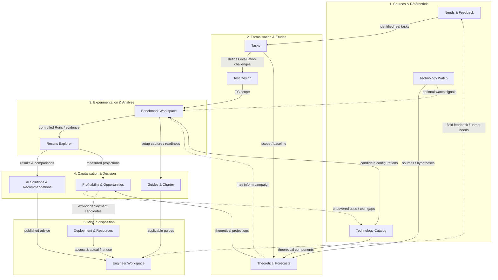

# AI Compass — Role-Based User Experience & Guided Navigation

> **Reference:** Product/domain specification maintained with the implemented application. The delivery tracker and outstanding UX acceptance work are maintained in the [implementation plan](future-evolutions/implementation-plan.md).

> **Contract:** Normative role-aware experiences, progressive disclosure, contextual navigation, shared component behavior, unsaved work and cross-persona acceptance criteria.
> **Decision context:** October 2026 refinement.  
> **Primary scope:** Role-adapted application entry points; one Workgroup knowledge-map/navigation hub; personalized engineer discovery; management entry point; independent governance entry; solution details; contextual navigation, breadcrumbs, steppers, local unsaved drafts and pragmatic concurrent editing.  
> **Separate future proposal:** [OS Compatibility & User Environment](os-compatibility-and-user-environment.md). This UX proposal **consumes** OS compatibility information; it does not define its technical catalog schema.  
> **Related work:** [Product Definition](product-definition.md) · [Platform Architecture & Data Governance](platform-architecture-and-data-governance.md) · [Benchmark Workflow](benchmark-workflow.md) · [Campaigns Server](campaigns-server.md) · [Test Cases Server](test-cases-server.md) · [Evidence-linked Recommendations](recommendations-server.md) · [Feedback & Discussions](feedback-discussions-server.md) · [Users & Access](users-and-access.md) · [Workload Planning DAP-01](workload-planning.md) · [Deployment & Adoption Planning](deployment-and-adoption-planning.md) · [Composable Setup Guides](composable-setup-guides.md) · [Campaign Evaluation Matrix](campaign-evaluation-matrix.md) · [Data Governance Audit Explorer](data-governance-audit-explorer.md).

> **Delivery target (2026-10-11):** Desktop web application (Demo and Server), not mobile/tablet. Minimum target: common desktop windows (1024px+); Chromium CI reference 1366×900. Do not require mobile-specific implementation, screenshots, device emulation or mobile acceptance. Accessibility still applies to desktop keyboard and assistive technology.

## 1. Product problem, intention and boundaries

Today much of AI Compass is exposed as a broad two-dimensional set of modules and navigation entries. Users must infer which data concerns them, which starting point answers their question, and how objects, evaluations and documents relate. The application appears as a complex website instead of a focused decision-support workspace.

**Product decision:** reorganize the *experience*, not replace the established business data or introduce a mandatory orchestration workflow. Start from each persona's needs, show only the appropriate high-level journey, and progressively reveal detail. Each view remains a projection over the **same authoritative catalog, Tasks, Test Cases, Campaigns, Forecasts, Runs, results, Recommendations, Guides, workload profiles and deployment records**.

Four purpose-built default experiences:

| Experience | Landing question | Main entry point |
| --- | --- | --- |
| **My AI Workspace** (Engineer/User) | Which AI tools help with my real Tasks, and how do I use them or give feedback? | Personalized Task tree with suitable tools and compact solution details. |
| **Management Insights** | Where are the annualized opportunities, benchmark maturity and deployed capabilities? | [Profitability & Opportunities](deployment-and-adoption-planning.md) by authorized organizational scope. |
| **AI Workgroup Studio** | How do user needs, watch, Forecasts, evaluations, results and adoption relate, and where can I work? | **One interactive categorized knowledge workflow** with directly navigable modules and a small number of resolvable attention counters. |
| **Maintenance & Governance** | Are data, schema, migrations, accounts and existing controls healthy? | Independent existing maintenance workspace; functions remain permission-scoped. |

**Non-goals:** four distinct applications or databases; customizable layouts; a new enterprise workflow engine; forced sequential knowledge pipeline; creating user-specific recommended-data silos; converting Feedback into support tickets; rebuilding permissions; new governance capabilities not previously scoped.

## 2. Cross-cutting interaction principles

1. **One shared model, several perspectives:** reuse authoritative domain IDs, version references and access rules. Avoid creating second copies of solutions, recommendations or guides only for a persona dashboard.
2. **Progressive disclosure:** relevant summary first, then object details, related guides/comparisons, and original evidence by navigation; no gigantic flat menu or all-at-once dependency diagram.
3. **Need-first landing:** an engineer sees their relevant tasks; management sees the profitability view; Workgroup sees its functional workflow; maintenance sees platform health.
4. **Direct functional navigation:** every Workgroup block acts as a link to its real workspace. No wizard forces entry into unrelated upstream stages.
5. **Context-retaining drilldown:** navigate Workgroup Studio → Benchmark Workspace → Campaign → Run and back through breadcrumbs. Likewise Task → Solution → Guide/Feedback, Opportunity → source result, etc.
6. **Appropriate steppers:** guided sequences only where the user is progressing through stages of the **same operation** (especially Run execution); not an application-wide process gate.
7. **Safe continuity:** the user should not lose incomplete form input by moving among steps, changing tabs/pages and returning. Browser-local **ephemeral drafts**, rather than unsanctioned server business revisions, support this.
8. **Pragmatic collaboration:** one experimenter edits one Run; shared business records use the backend's existing **optimistic expected-revision concurrency**, no global locks or automatic conflict merger.
9. **Calculated suggestions:** suitable solutions appear automatically from profile-relevant Tasks and published comparable evidence, but Forecast is never misrepresented as a successful measured Benchmark; editorial opinions remain distinct.
10. **Navigation permissions ≠ backend authorization:** selecting a persona never grants access. API authorization, publication and sensitive-data rules remain authoritative.
11. **Desktop web accessibility/performance:** mouse/keyboard and assistive-technology navigation, readable icons/text, sensible large-list search/filter, no reliance on arrows/colors/counter alone for meaning. Mobile and touch-specific acceptance are out of scope.
12. **Do not invent operational status:** status chips, attention counters and readiness claims must derive from explicitly modeled and resolvable states.

## 3. Role-aware spaces and interface switching

Users are **multi-role**. A person can be an Engineer, Workgroup contributor/reviewer, management viewer and/or maintainers/administrators depending on their *actual permissions*. Roles are **composable and not a privilege hierarchy**; in particular a Platform Administrator or User Administrator is not automatically an authorized Workgroup contributor or Data Maintainer.

**Recommended UX:** keep one authenticated session and show an avatar/account menu in the top-right corner containing the **available experiences**. Selecting one switches the interface context immediately; **do not require logout/login** just to enter another granted workspace. Include explicit label/current space, so role context is unmistakable. Users with only one eligible experience should not see a redundant selector.

- The space list is **derived server-side from current grants** (not all four blindly exposed to every authenticated user). Enforce the same grants in API requests.
- An owner/designer who needs to view all four can do so **provided the account has explicitly received the corresponding independent grants**; never implement a universal UI "admin bypass".
- The chosen experience may be remembered as a **per-account UI preference** (scoped to user + Server/Demo), with a safe fallback if grants have changed. It is not a separate authentication identity.
- Default landing on login: the last valid selected experience, otherwise a role-appropriate default. Exact priority for an account with no recorded preference is a UI implementation decision, not a new authorization rule.
- Context and breadcrumbs remain valid only as long as permissions/objects remain accessible. An unavailable deep link shows a proper access/unavailable state, not leaked content or silent reassignment to another role.
- The existing **/maintenance** separation and the ability of a maintenance-only user to work without business access remain intact. User Administration remains restricted to **users_manage** (and platform-specific rights where applicable).
- Keep Server and Demo routes/providers distinct; switching experiences never imports browser Demo records into the real server.

> **Workgroup Task taxonomy editor:** [Task Explorer view specification](task-explorer-workgroup-ui-spec.md) and [standalone prototype](prototypes/task-explorer/index.html). The permanent Task taxonomy (Tasks as leaves only), editable categories, multi-valued classification families and initial human-effort estimate are a proposed Workgroup editing UX; user-facing Engineer Task discovery remains a separate role-aware projection.

## 4. Engineer — My AI Workspace> **Workgroup Test Design destination:** [simplified UI contract](test-design-workgroup-ui-spec.md) · [HTML prototype](prototypes/test-design/index.html). Reuse the Task Explorer collapsible hierarchy; the Test Design editor shows campaign associations and their original Campaign statuses, not solution coverage. Omit statistics, right panel, reset-demo, version and fork UI. Backend history is preserved.

### 4.1 Primary landing, deliberately minimal

Default screen is an **expandable hierarchical list of relevant Tasks** on the left, with a compact selection of **recommended, published and applicable AI tools/configurations** opposite each Task. Derive relevant Tasks primarily from the user's **JobRole, Specialty, WorkloadProfile and overrides** from [DAP-01](workload-planning.md) when authorized/planning data are available; offer a meaningful no-profile/unknown state rather than fabricating an occupation or silently claiming no eligible tools.

Task tree structure reuses the permanent Task hierarchy (not a bespoke recommendation taxonomy). Distinguish profile-inferred Tasks from manually confirmed user Tasks if appropriate, and do not require end users to edit the formal taxonomy.

**Permission/implementation boundary:** DAP-01 currently exposes workforce profiles and rates only to the independent **deployment-planner** permissions, not to ordinary engineers. Personalized My AI Workspace must therefore receive an **authorized user-scoped, privacy-filtered projection of that person's relevant Tasks** (or an appropriately approved simplified derived view), **not** grant every engineer the unrestricted planning_view API or disclose confidential rates, other workers' allocations and organizational assumptions. Until such a projection exists, show a transparent fallback rather than pretending the current Server engineer API already provides private workload data.

**Default "By Task" projection:** each expanded Task shows the best few suitable configurations (e.g. top 2–3) with concise name, main use case, benchmarked qualification/uncertainty, accessibility and platform compatibility. The exact top-N/score formula remains a product-scoring policy, **not a fabricated hardcoded ranking**. Show a clear "More relevant options" affordance rather than dozens of side-by-side columns.

**Inverse "By Tool" projection:** list tools relevant to this same user and, under each, the relevant Tasks they serve. Both are views of one Task ↔ configuration ↔ measured evidence/recommendation relationship; they must not be independently curated inventories.

**Global discovery is intentionally secondary:** a small "Explore all Tasks and solutions" link/menu route opens a full discovery/catalog Results Explorer view. Do not place a second massive grid or all company Tasks on the engineer's default dashboard. Browsing other specialties, unassigned Tasks or experimental alternatives remains possible without diluting primary relevancy.

### 4.2 What qualifies as a recommendation

- Prioritize **published**, *relevant*, **actually measured and qualified** configurations where evidence is sufficient, with current limits, quality/DoD, applicability and publication status considered. A published failed Run is evidence, **not** endorsement.
- A Forecast may help users discover a promising theoretical candidate, but should be in a **separate explicitly labeled theoretical/experimental context**, not quietly ranked as proven.
- Calculate default personalized **presélections** from the user's Tasks, applicable measured outcomes, available editorial guidance, configuration and access compatibility. No mandatory manual Recommendation entry for every visible relevant configuration; exact ranking/scoring algorithm is separate versioned logic to be specified and justified.
- Retain published **editorial solution profiles** (general descriptive uses, limitations, peculiarities, context) alongside the measured results. **They must never manually override, promote or demote the rankings derived from the published experimental methodology.** If objective validation of applicability requires an exclusion, encode/test it through the methodology or an explicit source-backed evidence rule — not an editorial rank override.
- Enterprise-level technology accessibility, **person-specific entitlement**, and Windows/Linux platform compatibility answer **three separate questions**; display them separately where relevant.
- The declared OS preference is a **prioritization criterion, not a permanent exclusion**. A highly relevant Linux-only tool must be discoverable by a Windows-only person as a **secondary "requires Linux" option** with clear explanation; see [OS Compatibility](os-compatibility-and-user-environment.md). Do not pollute the primary shortlist with unrelated tools.
- For configurations comprising Model + Provider + Harness and possibly a Framework, preserve exact identity/version and do not treat a theoretical candidate as an already registered measured AI Solution.

### 4.3 Solution detail is the one contextual hub

Clicking a recommended solution opens a **compact AI Solution Detail**, ideally in a drill-in page/side panel that the user can leave without losing their Task context:

| Area | User sees / can do |
| --- | --- |
| **Why this solution?** | Suitable Tasks, intended uses, source of ranking, evidence coverage and key limitations. |
| **Accessibility** | Enterprise availability and whether this person can actually use the complete configuration; if eligible but not equipped, offer a visible **request access** action. |
| **OS compatibility** | Available Windows/Linux targets, current user OS, and alternative-OS benefits even if not currently installed. |
| **Get started** | Contextual User Guide, applicable Setup Guide for **exact assembled configuration**, and links to general charters/FAQ/training. |
| **Feedback** | Feedback action for tools the person has used/access to; existing discussion view and original message context where permitted. |
| **Evidence** | Concise measured assessment and progressively explorable sources; deep Results Explorer links for people with appropriate access. |
| **Other uses** | Other Tasks covered by the same configuration; navigate to them without returning to a flat catalog. |

**Guides & Charter:** general charter can have its own compact independent entry, but it is also accessible contextually from the selected solution. Reuse [Composable Setup Guides](composable-setup-guides.md): reusable component modules → recipe of the exact Model/Provider/Harness/Framework/version/environment → one rendered solution-facing guide; avoid duplicating or manually assembling pages in the user's mind. Distinguish **User Guide/how to use** from detailed installation/reproducibility **Setup Guide**, and don't imply all generic guides validate a tested composite.

### 4.4 Feedback, unmet needs, interest in access

Offer **three distinct, intuitive actions** near the user's relevant Task/solution, using the **existing** feedback/discussion and future deployment domains:

1. **Feedback on actual use:** accessible tool → short contextual feedback thread linked to the measured solution/Task, using existing one chronological public/internal discussion model and existing corrections/attachments.
2. **Request access/express interest:** planned-eligible person without effective entitlement → small request entry point; where useful, associate a discussion thread. The **approval/provisioning status belongs to Deployment & Access**, not to the discussion thread's message state. No automatic grant or purchase.
3. **Submit a new need or technology idea:** from Task tree or personal workspace, simple prompt for the activity/problem, proposed tool if known, expected benefit, optional supporting context. Reuse existing ordinary-user Feedback/Ideas/Requests; Workgroup may later map the need to formal Tasks/Watch/Forecast **without an automatically mandated To-Do**.

**Do not convert Feedback & Discussions into a support-ticket lifecycle.** Public and internal messages remain in a single time-ordered discussion; private internal content never leaks into the user experience. In the current Server discussion API, thread contexts support existing Task/component/measured-solution IDs; extension to future planning targets should be an **explicit integration**, not an assumption that arbitrary Forecast or deployment IDs can already be targeted.

### 4.5 General Workgroup updates — second entry point

A distinct, lightweight **Workgroup Updates / What's New** page or navigation affordance shows **globally published** information: newly published measured results and campaigns, updates to solutions/guides, new available technologies and other release/knowledge news. This is **general knowledge**, not restricted to the reader's own Tasks; allow later filters but no mandatory personalization.

Do not repurpose the privileged full Activity Feed/Audit Explorer as a public news source. Derive a safe publication-focused read model from attributable existing objects/events **once their visibility and event coverage support it**; never show unpublished Forecasts, internal Watch hypotheses, draft campaign details, restricted content or administrative account changes.

## 5. Management — Management Insights

Default entry: [Profitability & Opportunities](deployment-and-adoption-planning.md), using its **Task-tree × candidate/solution heatmap**, shared intensity-only economic encoding and icon-only evidence/deployment status. Management can inspect:

- **Activated Potential, Benchmarked Opportunity and Forecast Opportunity**, with a cumulative total and forecast/benchmark/deployment breakdown;
- evolution/history snapshots, what changed and why, uncovered Tasks and unquantified ideas;
- filtered organizational/team/job/specialty scopes permitted by grants;
- click-to-explore factors/source versions via the **progressive Evidence & Calculation Explorer**, without all derivations on screen at once;
- links to deployment/resource-planning status where permitted, without requiring operational benchmark editing navigation.

Default scope is the leader's **authorized responsibility area** (not blanket enterprise access just for possessing a "manager" label); allow authorized scope changes. Protect employee-level workloads, rates, access details and private experimental drafts in all tooltips/exports/source drilldown. Do not turn "activated estimated potential" into reported actual cash savings.

The profitability matrix and its calculations are defined in **DAP**, not reimplemented as a separate management data store or a second heatmap engine here.

## 6. AI Workgroup Studio — one categorized navigable knowledge map

> **Approved Technology Catalog Workgroup prototype:** [UI spec](technology-catalog-workgroup-ui-spec.md) · [interactive HTML](prototypes/technology-catalog/index.html). Search Models/Providers/Harnesses/Frameworks, maintain enterprise accessibility, relevant pricing, capabilities/limits and linked setup Guides. No maturity field, standalone revision-history tab or model pricing tab; immutable backend audit persists.

> **Needs & Feedback Workgroup destination:** [approved content-view specification](needs-feedback-workgroup-ui-spec.md) · [standalone HTML prototype](prototypes/needs-feedback/index.html). The view supports list/search/filter at left, a chronological conversation at center, metadata at right, and a compact summary/action strip. Requested new status/priority/type features are explicit pending business-model changes, not existing capabilities.

> **Visual implementation reference (candidate):** [Workgroup homepage UI contract](workgroup-studio-home-ui-spec.md) · [standalone HTML map prototype](prototypes/workgroup-studio/index.html) · [view design handoff](prototypes/workgroup-studio/DESIGN.md). This is a *content-only* map view; no header/footer or lateral menu is specified within it. All domain behavior and the complete semantic graph below remain normative; prototype styling does not override them.

### 6.1 Main design decision

The Workgroup default landing is **ONE integrated diagram** that is **simultaneously a knowledge/workflow explanation and direct navigation surface**. There is **NO separate operational workflow diagram, alert dashboard, personal action queue or forced path**.

Preserve the five domain groupings (visually distinct sections); make the four/five study cores prominent: **Technology Catalog, Tasks, Test Design, Benchmark Workspace, Results Explorer**. Other blocks are equally accessible but visually secondary to the engineering evaluation cores.

**Five themed zones:**

| Zone | Blocks / responsibility |
| --- | --- |
| **1. Sources & Référentiels** | **Needs & Feedback** (user voice), **Technology Watch** (hypotheses/sources), **Technology Catalog** (Models, Providers, Harnesses, Frameworks independent of benchmarking). |
| **2. Formalisation & Études** | **Tasks** (editable taxonomy tied to real jobs/needs), **Test Design** (reusable Test Cases and fork lineage), **Theoretical Forecasts** (Task-linked theoretical predictions). |
| **3. Expérimentation & Analyse** | **Benchmark Workspace** (Campaigns, sessions, reviews/publication), **Results Explorer** (measured runs, coverage, solution/task comparisons; forecast comparisons explicitly theoretical). |
| **4. Capitalisation & Décision** | **AI Solutions & Recommendations**, **Guides & Charter**, **Profitability & Opportunities**. Recommendation editorial lifecycle preserved, not duplicated into a second technology inventory. |
| **5. Mise à disposition** | **Deployment & Resources** (deployment, external access, quotas/budget when the DAP feature exists), **Engineer Workspace** (user-facing knowledge and discovery). |

### 6.2 Diagram reference — semantic links, not mandatory transitions

The following is the **conceptual graph / navigable-home information architecture**, not a rule engine or a promise of automatically created objects. Block labels may carry a small derived count **when eligible** (see §6.3).

**Meaning of arrows:**

- Needs may motivate Tasks (no automatic Task creation); Tasks define target activities; Test Cases are distinct reusable concrete challenges.
- Watch Signals + sources can support Forecasts; Catalog components compose theoretical configurations; a Forecast is not itself a measured AI Solution.
- Campaign planning consumes chosen Test Cases/configurations, and *may* reference Forecasts/Watch. A member may create a Campaign **directly** without prior Forecast or Watch.
- Campaign executions produce immutable Runs; Results Explorer reads and compares the resulting evidence. Published failed Runs still count as experiments, not positive recommendations.
- Workgroup editorial Recommendations derive from supported, appropriately published evidence; Guides can be drafted/used **before or during** Runs, with documentation completeness evaluated at relevant campaign review — the arrow does not imply guides are generated only after results.
- **Forecasts AND measured evidence** can feed the DAP opportunity projection, with correct maturity and calculation rules.
- Profitability can expose **Task/technology coverage gaps**, allowing contextual navigation **back to Technology Catalog** to explore candidates. This is a knowledge-discovery link, **not automatic catalog entry creation**.
- Only explicitly selected opportunities feed the DAP deployment/resource-planning targets. Access availability and first-use status inform the engineer view and backflow to profitability; no invisible purchasing/provisioning.
- Engineer knowledge exposure draws from published results, guidance and deployment availability; field feedback may motivate new needs, not compulsory investigations.

Technology Catalog contains **component records**; the AI Solutions section displays **assembled measured configurations**. Do not conflate them. Framework collaborative Run results remain composite and cannot be claimed as an individual participant's metrics.

### 6.3 Single resolvable attention count on eligible blocks

The User requested **one simple count directly on the diagram box**, not a separate operational workflow, personal To-Do list, distinct multi-color attention classes or user assignment. The count is **aggregate for the module** (within the scope of records the viewer is permitted to know), and **does not depend on who is personally entitled to resolve the item**. It means roughly "N existing records currently require a defined completion transition."

**Strict eligibility test:** count a record only if its **existing structured model** provides both (a) unambiguous unresolved/actionable state and (b) a recognizable resolution/exit state. If the state cannot be resolved using existing data, **show no count** for that block. **Do not add new domain status fields, assignments or a fictitious resolution workflow** solely to support counts. Suppress zero/absent badge rather than filling every node with "0".

| Block | Initial derivation policy | Resolution / reason |
| --- | --- | --- |
| **Benchmark Workspace** | **Count campaigns Under review** (other real blocked/pending conditions only if modeled with clear resolution). | Publish or valid rework/reopen/unpublish transition; avoid equating all In Progress campaigns with an action pending. |
| **Theoretical Forecasts** | **Count staged forecasts awaiting documented review**, only where the implemented lifecycle exposes this exact state. | Review/publish/rework into nonpending state. |
| **AI Solutions & Recommendations** | Optional count of existing recommendations **in_review** and/or **review_needed** where their modeled review completion is clear; no double count per object. | Review/publish/revise according to existing Recommendation lifecycle; avoid "all draft recommendations are overdue". |
| **Deployment & Resources** | When built: outstanding **explicit access approval requests** with a resolvable request status. | Approved/rejected or specified terminal decision, never merely a Forecast unacted upon. |
| **Technology Watch** | **No count** merely because a signal has not yielded a Forecast or Campaign. | No modeled obligation/closure; an unexploited signal may be perfectly acceptable. |
| **Needs & Feedback** | **No pending-resolution count**: threads currently lack a true triage/closed status. | An unanswered discussion message is not an invented ticket status. |
| **Tasks, Test Design, Technology Catalog, Results Explorer, Guides** | **No default count** unless an existing explicit obligation has a reliable resolution; publishing readiness in future guide evolution may eventually qualify. | Unknown/empty records and simple totals are not attention counts. |
| **Profitability & Opportunities / Engineer Workspace** | **No default attention count** for large uncovered opportunity/idea populations. | Exploration ≠ outstanding duty. |

Display the small badge near/on the block, e.g. "Benchmark Workspace · 3"; don't imply **3 personal assignments**. The badge is read-only derived, refreshed from the same authoritative object states. **Click block:** open the module. **Click badge:** optionally open that module with the source filter preapplied; do not mutate the objects by viewing. Counts visible to each account may be restricted by *read authorization*, not by personal task ownership.

**No new separate workgroup operations dashboard:** the current read-only campaign pipeline remains available **inside Benchmark Workspace** as a list/filtered overview when this new landing experience is introduced; preserve published campaign actions and their existing owners.

## 7. AI Solutions, Results Explorer and Recommendations — no redundant catalogs

> **Latest approved AI Solutions Workgroup view:** [UI specification](ai-solutions-workgroup-ui-spec.md) · [standalone HTML prototype](prototypes/ai-solutions/index.html). Default inventory is the minimal qualified portfolio **union already published solutions**, not the complete measured inventory; Results Explorer retains the full measured catalog. Classification is by phase or specialty, without visible Tasks. Editorial note, compatible auto/manual Guide links and explicit publish/unpublish with immediate readiness diagnostics belong here. Qualification/recommendation/publication remain separate authoritative decisions.

> **Results Explorer UI decision:** [read-only view specification](results-explorer-workgroup-ui-spec.md) and [HTML prototype](prototypes/results-explorer/index.html). The result browser has no create/edit Evaluation actions. Eligible published, accepted individual measured solution evidence feeds a candidate projection to AI Solutions, where editorial work, guides and engineer visibility are handled. Do not assume a Forecast or composite workflow qualifies an individual solution.

**Existing verified state:** [PLAT-22](recommendations-server.md) already implements a *manual reviewed recommendation* pinned to an exact **Task, measured individual AI Solution, individual Benchmark Run(s), optional Evaluation revision**, with evidence, rationale, limitations, historical revisions and controlled Draft → In review → Published/unpublished transitions. Publishing benchmark evidence does **not** automatically publish a recommendation. New evidence may produce **review_needed** without silently rewriting the historic editorial decision.

**Desired UX:**

- **Technology Catalog:** only Model/Provider/Harness/Framework components and their metadata, not the canonical inventory of individually measured setups.
- **Results Explorer:** authoritative analytical point of entry for **all recorded measured AI Solutions** and relevant composite workflows, filtering, sorting, compare by Task/solution, sources, campaigns, individual Runs, DoD results and theoretical Forecast overlays when appropriately labeled.
- **AI Solutions & Recommendations (Capitalisation):** navigate the complete **measured solution inventory**, not just "best" solutions; browse/sort/filter relevant properties and follow a solution to **results, linked campaigns, documentation, linked recommendations and limitations**. Prefer a **composed view over the Results Explorer and existing Recommendation editing flow**, not an invented duplicate solutions database.
- **Recommendation editing:** retain the existing Workgroup-authorized **Recommendations** screen/route/editor and its reviewed, exact Task/Solution/Run-pinned historical objects. Reposition its *product meaning* as **editorial, descriptive AI Solution context** (general strengths, limitations, particularities) accessible from a solution/task, not an independent ranking, enforced person assignment or qualitative veto over the objective benchmark-methodology results. Editing/reviewing this object never changes a measured Run or the algorithmic score.
- **Engineer selections:** calculate the shortlist from eligible **current effective, published and methodologically qualified measured results**, the person's Tasks and access/OS constraints. **Editorial Recommendations supply description and limits, not ranking or qualification overrides.** No mandatory editorial record per Task × Solution; published theoretical Forecasts remain separate from measured suitability. Failed-DoD, withdrawn or incomplete Runs cannot be promoted as validated evidence.
- **User documentation:** resolve Setup Modules/Recipes (once future Guide composition exists) and general charters to an assembled solution view, including exact versions and environment. Do **not** duplicate per-component docs into editable copies in each solution.
- A special free-standing **"generic recommendations for every solution" database or new authoring lifecycle is NOT authorized** by this UX proposal. Existing Task-linked editorial recommendation data are kept; general readable solution summaries/limitations may be projected from allowed fields. Any genuinely new cross-Task editable recommendation model needs separate approval.

This **retains the Recommendations feature** as the user expressly decided, while reducing redundant Workgroup navigation and centralizing per-solution exploration. Existing historical recommendations continue to work exactly as published with their pinned originals.

## 8. Breadcrumbs, return paths and deep-link navigation

There are **two complementary navigation patterns**:

### 8.1 Hierarchical/contextual navigation (top-down and bottom-up)

Examples:
- Workgroup Studio → Benchmark Workspace → Campaign → Run → exact revision/evidence;
- My AI Workspace → Task → AI Solution → Setup Guide / feedback thread;
- Management Insights → opportunity cell → calculation factor → Forecast / measured Run;
- Results Explorer → AI Solution → Recommendation → original Test Cases and Runs.

Use **breadcrumbs** showing the meaningful route/parent context, direct links to previous levels, and a **return-to-origin** action. Since one record may be reached from different entry points, **do not force a single canonical "back to Benchmark Workspace" path**: preserve its navigation context where safely available, while keeping stable deep links to canonical object IDs/revisions. Browser back/forward should behave normally.

List filters, search, expanded Task branch, result scope and scroll position should survive routine detail drill-in/back navigation when practical (route/query state or short-lived UI state; not an authoritative data mutation). When a historic pinned revision is being viewed, clearly label it and do not substitute current data silently.

The diagram remains an **entry map** rather than an obstacle: user can navigate directly from bookmarks/deep links or a related object.

### 8.2 Guided steppers for genuinely sequential local operations

**Ideal first candidate:** the existing guided **Benchmark Test Run** process, reflecting [Benchmark Workflow](benchmark-workflow.md):

1. Campaign / execution context;
2. Test Case (challenge and acceptance criteria);
3. Installation & Setup Guide / environment;
4. Timed interactions (human and agent time, prompts, artifacts);
5. Results, evidence, metrics and Run close.

A stepper may allow prev/next and visits to earlier valid steps, show progress and explicit blocking validation when necessary, and save local incomplete input between steps. **Do not imply each step itself creates/publishes a new Campaign or Run**; adhere to the actual existing session and close semantics.

**Campaign object itself is not a fixed five-step wizard.** It can contain many Test Cases/Runs, be concurrently edited by different Workgroup members, be reopened and retain published revision history. Use a stable Campaign detail with contextual sections/tabs and guided **individual** sessions. A stepper on creation may be used if the form genuinely benefits, but must not create mandatory upstream Watch or Forecast requirements.

Other suitable stepper candidates may include explicit multistage setup/validation tasks where a real ordered operation exists. **Do not apply steppers to general catalog discovery, Tasks navigation, Results Explorer, Knowledge Watch or the whole Workgroup diagram**.

## 9. Unsaved form work: simple local autosave and safe invalidation

### 9.1 Objective and separation of ownership

A user can begin a campaign edit, fill a multiline form, switch tabs/steps/pages, reload or return later in the **same browser** and recover unsaved fields and active step. This is a local **ephemeral working copy**, not a committed business record, shared collaboration channel or promise of multi-device resume.

Use existing browser-local persistence mechanisms (e.g. **localStorage**, namespaced safely), for **unsaved form fields and active step only**; compare source object version before any server submit. Server mode's authoritative data still lives on PostgreSQL; the local cache must **never** impersonate or replace server persistence, and never fall back to Demo data after a Server API error.

**Minimum draft envelope:**
- runtime mode (Demo vs Server) and origin/tenant;
- authenticated account identity (or clearly distinct simulated Demo account);
- workspace/form kind and object public ID or client-generated *temporary draft key* for unsaved new forms;
- base object revision / method-schema version and draft format version;
- partial form data, active step, saved-at timestamp; optionally non-sensitive UI context.

**Avoid storing** passwords, API keys, bearer tokens, secrets, confidential binary EvidenceBlob/attachments or raw files in localStorage. File attachments remain on the current managed evidence-upload system or must be reselected when needed. If retention of particular sensitive R&D free text on local disk violates policy, those fields must be excluded/covered by appropriate approved treatment rather than assumed safe.

### 9.2 Simple resume behavior

1. Load the real current object/revision and check whether a matching local draft exists.
2. If user+mode+object+schema still match, offer **Resume draft / Discard draft** (or safe explicit restoration) and land on the remembered step.
3. Autosave changes and step transitions locally; show subtle "Saved on this device" so it cannot be mistaken for server commit.
4. **On successful server save/close:** clear or update the corresponding local draft (including stale old-version copy).
5. **On explicit discard/logout/role switch:** do not expose drafts in other accounts/spaces. The draft may remain under the same account's isolated namespace if intended for later return; user should have an explicit way to discard it.
6. Prune expired/unneeded drafts with a simple retention limit and handle quota/storage-disabled errors without hiding unsaved data loss warnings.

**Local draft invalidation is acceptable rather than migrating drafts:** if draft format or method schema becomes incompatible after an application/schema migration, drop/invalidate the local draft and reload the current server form. A harmless schema update should not force historical business migration. **Never rewrite business object migrations for the convenience of browser cache.**

**If base object revision has moved, DO NOT silently reapply the old draft to a newer object.** Present the newer server state and a conflict notice, preserving the existing draft for manual recovery/copy until user discards or reconciles. A draft is not authority to overwrite collaborators.

**Existing Demo behavior is separate:** Demo already uses localStorage as its **authoritative fictional dataset** and persists example sessions. Keep demo records and new ephemeral form drafts in **separate namespaces**, without cross-mode mixing and without treating server drafts as imported Demo business objects.

## 10. Minimal multi-user concurrency, without a general merge engine

### 10.1 One experimenter owns one Run execution

One Test Run/session's active execution and input are **owned by one explicit experimenter**. Different users may contribute **distinct sessions/Runs** to the same Campaign. Do not offer collaborative simultaneous editing of a single active Run. Other permitted users may view appropriate results or campaign-level progress; the server must enforce **Run/session editor ownership** when such persisted sessions are available. Browser-only locks are not security or concurrency protection.

On Run finalization, freeze its measured timeline, configuration, original evidence and provenance under the existing Run immutability guarantees. Editing campaign metadata cannot repurpose someone else's Run or rewrite its evidence. If an abandoned Run needs exceptional reassignment, that is a **future explicit policy**, not an implicit shared-edit feature here.

### 10.2 Shared objects: retain existing optimistic concurrency

**Verified existing backend mechanism:** Model catalog, Campaigns, Test Cases, Recommendations and DAP-01 Workload Profiles use immutable revisions and **expected_revision** checks; a stale edit receives **HTTP 409**. Preserve that strategy. Do **not** lock the whole Campaign during normal work or introduce CRDT/real-time collaborative text editors/automatic merges.

Concrete scenario:

1. Alice and Bob open Campaign **r005**.
2. Alice saves allowed changes → server creates immutable **r006**.
3. Bob tries to save a form based on **r005** → server responds 409; no partial overwrite.
4. Keep Bob's unsaved local draft intact. Show "Campaign changed since you opened it", latest revision and option to **reload latest**, review changed fields and *manually reapply/copy* Bob's input before a new authorized save.
5. Never silently replay the old full object or auto-merge nested configuration, reference lists, Test Case selections, waiver decisions, exact setup pins or history; such transformations require explicit conscious reapplication.
6. Validate server-side permissions, Task/Test Case links, reference revision pins and current lifecycle constraints in a new transaction. The successful save produces a new immutable revision and attributable audit event.

**Independently created Runs/sessions** should not unnecessarily prevent each other from being recorded if they are separate authorized objects; however, any campaign-wide list/plan mutation must follow the campaign's consistency/revision policy. More granular locking **may** be considered later only if actual conflicts make whole-object optimistic revisions unusable.

**No automatic overwrite on step changes**: a stepper transition can update local drafts; only an intentional domain action commits server data. Error recovery must keep the user's partial input unless intentionally discarded.

### 10.3 Explicit nonrequirements

No automatic field-level merge; no cross-user shared unsaved drafts; no WebSocket presence/typing indicators; no global campaign checkout lock; no migration of transient browser drafts; no general conflict-resolution administration screen.

## 11. Maintainer experience remains a separate controlled workspace

**Maintenance & Governance** is an independent default entry when grants permit. It presents existing/planned platform capabilities as a concise coherent overview and contextual drill-down, **without inventing new administrative operations**:

- **Data Health:** broken/missing/obsolete records, structured quality checks and maintenance triage.
- **Schema & Migrations:** compatibility and permitted previews/executions where existing rights and controls allow.
- **Data Governance Audit:** passive, permission-filtered recorded changes, exact revisions and diff inspection, as provided by the committed-change Audit & Changes workspace.
- **Users & Access:** AI Compass accounts and RBAC, **only** for user administrators with explicit grants; not external Provider credentials.
- **Integrity & Recovery / Platform Operations:** existing authorized backup, integrity, restore-test and operational summaries; production operations require their independent privileged controls.

Data Maintainer **must not automatically** gain Workgroup business editing, publishing, Users & Access or platform operation rights. Administrative interface switching is composition of genuine permissions, not permission inheritance. The user asked for a review of the long-term overview **only**, not expansion of governance scope.

## 12. Architecture: reuse and preliminary impact

**Technical direction:** maintain same frontend with independent Demo and Server adapters, Django/PostgreSQL authoritative models, immutable history and composable RBAC. The current Demo/Server pages are *not yet genuinely shared*: implementation must converge them while delivering this UX redesign rather than first duplicating the legacy screens in a separate refactor. [Shared Frontend, API Contracts & Release Lifecycle](shared-frontend-and-release-lifecycle.md) owns the provider boundary, build artifacts, compatibility and deployment requirements; this UX specification owns persona navigation and presentation semantics. Do not invent a different backend contract for each persona or mode. Implement **route/shell composition, reusable contextual panels and derived read-models**, not separate underlying repositories of advice or a new workflow service.

| Component | Impact | Approach |
| --- | --- | --- |
| **Role-aware app shell** | Medium–high | Resolve eligible experiences from actual permissions; top-right switcher; per-account last chosen space; preserve /maintenance isolation. |
| **Engineer Task/Tool projection** | **High** | Join DAP workloads/tasks to measured solutions, evidence, published editorial opinions, actual user access and OS compatibility. Provide no-profile fallback and secondary global discovery. |
| **Solution Detail** | Medium–high | Reuse one measured-solution identity to present related Task results, recommendations, guides, feedback and deployment facts; no copied catalogs. |
| **Workgroup diagram** | Medium | One categorized desktop web graph, link/deep-link mapping, optional computed status count. |
| **Status count read projections** | Low–medium | Count only already resolvable states; no new status transitions; permission-filtered aggregation. |
| **Results/Recommendations** | Medium | Retain existing PLAT-22 editor; integrate navigation into Solutions/Results; computed ranking distinct from editorial recommendation publication. |
| **Breadcrumbs/deep links** | Medium | Stable object/revision-aware routes, originating context and preserved list filters where possible. |
| **Stepper & draft cache** | Medium | Reusable wizard-state component; scoped ephemeral browser cache with schema/base revision invalidation and safe cleanup. |
| **Concurrency UX** | Medium | Reuse existing expected_revision/409 API; show conflicts and explicit manual reload/reapply, owner-only Run editor. |
| **Management landing** | Low–medium dependent | Reuse DAP opportunity matrix/history/provenance; avoid duplicate engines and scope confidential workforce data. |
| **Maintenance landing** | Low | Repackage authorized existing tools; retain independent routes and permissions. |
| **Security / Demo parity** | Cross-cutting | Server-side permission checks, publication visibility, CSRF, independent modes and smoke coverage. |

**Dependency discipline:** Reuse authoritative domain models and actual permissions for OS compatibility, Guides, workloads, access and historical evidence. Preserve fail-closed states and do not fabricate source values.

## 13. Recommended UX validation journeys

1. **Engineer with defined job/specialty:** logs in, sees only relevant expandable Tasks and a few measured best-fit solution recommendations; can toggle **By Task / By Tool**, open solution details and its context-appropriate guide, return with Task branch/filters preserved.
2. **Engineer with Windows only:** sees Windows-capable tools first; a useful Linux-only alternative remains discoverable with **Requires Linux**; changing OS selections updates relevant rankings without deleting research or user profile history.
3. **Engineer without complete workload profile:** sees explicit profile-not-configured state and useful way to explore published solutions without invented Task membership.
4. **Engineer with access:** can submit authentic usage feedback linked to measured solution/Task; discussion preserves Public/Internal permissions.
5. **Engineer deployment-eligible but lacking access:** can express interest/request access; discussion and structured DAP access request are properly linked when DAP is available, not accidentally modeled as a ticket.
6. **Engineer proposes new use:** can submit simple idea from Task context; does not create a mandatory Watch/Forecast/Task or assigned Workgroup To-Do.
7. **Engineer follows Workgroup Updates:** sees published platform knowledge, never internal drafts/privileged Activity Feed events.
8. **Multi-role user:** switches Engineer → Workgroup → Management → Maintenance via menu **only when permissions allow**, without logout, and cannot obtain unavailable APIs by manually selecting route.
9. **Workgroup Studio:** loads the **five themed blocks**, emphasizes core study areas, provides accurate semantic links and no mandatory sequence, including the **Profitability → Technology Catalog** opportunity-gap link.
10. **Counters:** Under-review Campaigns show a single count; clicking can filter. Technology Watch/feedback with no closure state show no artificial pending count. Same count is not individualized by owner/action rights; it remains subject to read scope.
11. **Direct path:** enters Benchmark Workspace from Workgroup diagram, opens Campaign and exact Run, uses breadcrumbs/browser Back to navigate up while retaining context.
12. **Run stepper:** traverses Setup → Interactions → Results, navigates away/reloads, and can restore local unsaved fields/step without generating phantom server Runs.
13. **Draft schema migration:** incompatible local draft is invalidated without any forced migration of authoritative campaign/evidence records.
14. **Concurrent Campaign:** user A saves r006, user B's stale r005 save returns 409 and keeps unsaved draft. No silent field overwrite or automatic merge.
15. **Run edit ownership:** a second contributor cannot simultaneously modify the first person's active Run, but can create a separate Run for the same Campaign if permitted.
16. **Recommendations:** a published editorial opinion remains linked to exact Task/Solution/Run, is editable through existing role-gated flow and appears contextually on Solution Detail without a duplicate recommendation catalog. An otherwise published failed Run does not become a positive recommendation automatically.
17. **Management:** lands on authorized DAP metrics and opens a sourced result without exposure of restricted individual rates.
18. **Maintenance-only:** enters /maintenance and existing authorized health views while lacking Workgroup business editing or accounts administration if not granted.
19. **Demo/Server:** shared frontend structure works with separately scoped real and synthetic records, local draft cache never crosses modes, and Server outages never trigger a fake Demo fallback.
20. **Navigation/accessibility:** desktop keyboard and assistive-tech users can traverse diagram nodes, counts, steppers and breadcrumbs. Mobile view adaptation is not an acceptance criterion.

## 14. Open implementation refinements, not blocking product decisions

- Concrete desktop UI layout for the categorized graph (graph vs grouped section cards); all five zones, blocks and link semantics must survive.
- Derivation, calibration and versioning of **automatic rankings**; quality/failure gates and relationship to published editorial limitations. Do not invent a scoring formula merely for presentation.
- Scope and eligibility for resolving tool-by-person access when only aggregated DAP cohorts are known; don't claim individual provisioning from cohorts.
- Choose precise UX wording/refresh strategy for the existing recommendation **review_needed** state and count without new status models.
- Browser draft retention limits, excluded confidential fields and safe recovery presentation under changing server revisions.
- Persisted session ownership enforcement where Server Run/session management is introduced; do not claim existing Demo's browser-local session implies cross-account Server isolation.
- The final grouping of **AI Solutions & Recommendations** as one navigation block or two connected subviews can be resolved in visual design, but keep **all measured solutions** browsable and the **existing editorial authoring** discoverable.
- Legacy Workgroup dashboard replacement/navigation alias strategy; preserve Campaign pipeline within the workspace and existing deep links.

These refinements must not justify unnecessary data-model rewrites or new user-facing mandatory workflows.

## 15. Explicit exclusions and delivery governance

- No loss or rewriting of original Recommendations, Runs, evidence, Guides, Catalog histories, account data or access permissions.
- No universal auto-publication of all benchmarks or recommendations; published controlled evidence **may contain failures** and editorial recommendations remain separate.
- No automatic actions triggered merely by diagram arrows, uncovered Tasks, Watch Entries, a strong Forecast or a profitability cell click.
- No operational dashboard distinct from the Workgroup diagram, no personal task-assignment interpretation of attention counters, no attention counts without a real resolution status.
- No replacement of the planned DAP profitability, resources and deployment screens; only role-specific **entry** and contextual links to them.
- No forced wizard for every Campaign, no collaborative editing of the same Run, no automatic multi-user merge engine.
- No credential renewal, shared-credit ledger, user account privilege escalation or new administrator capabilities.
- No separate per-role database, hardcoded "admin has every role" exception, personal UI drag-and-drop customizer or unnecessary service layer.
- No creation of implementation tickets (GitHub/Jira), migrations or source-code changes by approving **this document**. It belongs to **future-evolutions** until a separately approved issue plan exists.

## 16. Integration with current published evidence and deferred platform cleanup

The [Publication & Information Lifecycle](publication-and-information-lifecycle.md) defines the active, corrected, complete and nonwithdrawn published measured **source set**. The Engineer shortlist, solution comparison/detail, general Workgroup Updates and Management opportunity entry must use that same effective source visibility; archived/withdrawn material cannot leak through a cached card, direct revision link or obsolete publication preview. Historical references remain permission-controlled.

**Ranking authority:** experimentally measured results interpreted under versioned methodology are decisive for suitability. Reviewed editorial Recommendation objects **remain editable and published as descriptive solution profile/limitations** but may not override the methodological result. User Guides and exact-environment Setup Guides are contextually rendered from [Composable Setup Guides](composable-setup-guides.md); [OS Compatibility](os-compatibility-and-user-environment.md) affects relevance but never permanently hides an interesting other-OS candidate.

**Navigation/maintenance boundary:** this feature owns only persona-specific entry, grouped Workgroup diagram, resolvable attention counters, breadcrumbs, steppers, ephemeral drafts, role switching and conflict UI. Physical deletion and automated orphan GC are **not** new generic UX actions: they are independently privileged **Maintenance & Governance capabilities defined by the lifecycle feature**, with [Data Governance Audit Explorer](data-governance-audit-explorer.md) providing passive audit inspection. Existing API authorization is always authoritative. The user's separate request to restructure repository-wide documentation is **deferred**; this file's path and baseline roles remain unchanged.
